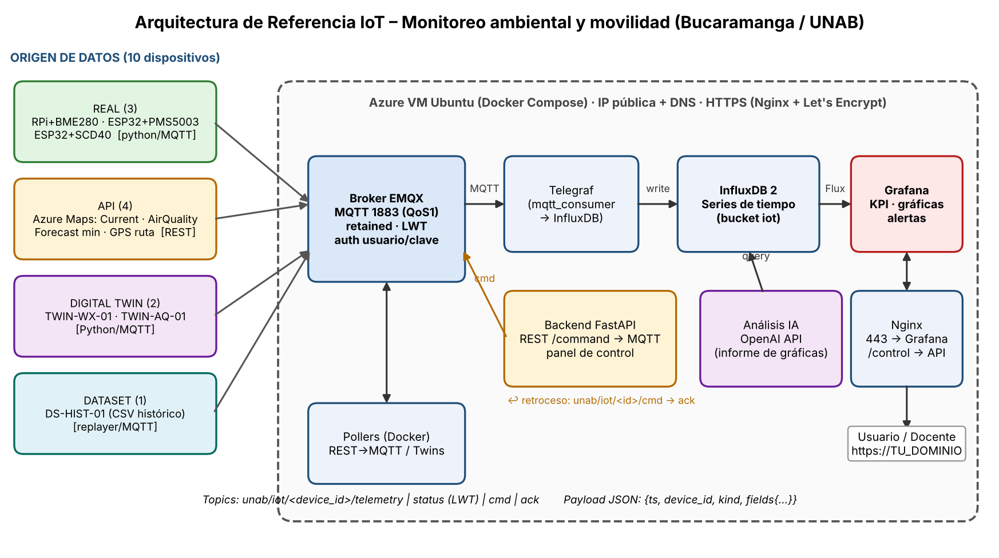

# Plataforma IoT UNAB — Parcial 2

Proyecto académico de Ingeniería de Sistemas para implementar una plataforma de monitoreo IoT desplegada en Microsoft Azure.

## Descripción

La plataforma permite recibir, almacenar y visualizar datos de dispositivos IoT virtuales y fuentes externas mediante una arquitectura basada en MQTT y contenedores Docker.

También incorpora un sistema de control bidireccional para enviar comandos a los dispositivos virtuales y recibir confirmaciones.

## Tecnologías utilizadas

- Microsoft Azure: infraestructura en la nube.
- Docker Compose: despliegue de servicios.
- EMQX: broker MQTT.
- Telegraf: procesamiento de telemetría.
- InfluxDB 2.7: almacenamiento de series temporales.
- Grafana: visualización de datos.
- Python: simulación de dispositivos y consumo de APIs.
- FastAPI: interfaz de control.
- Nginx: proxy inverso con HTTPS.

## Arquitectura

Flujo principal de telemetría:

Dispositivos y APIs → MQTT (EMQX) → Telegraf → InfluxDB → Grafana

Flujo de control:

FastAPI → MQTT → Dispositivo virtual → Confirmación (ACK)

## Fuentes de datos

La plataforma integra 10 fuentes activas:

| Identificador | Tipo |
|---|---|
| TWIN-WX-01 | Dispositivo virtual meteorológico |
| TWIN-WX-02 | Dispositivo virtual meteorológico |
| TWIN-WX-03 | Dispositivo virtual meteorológico |
| TWIN-WX-04 | Dispositivo virtual meteorológico |
| TWIN-AQ-01 | Dispositivo virtual de calidad del aire |
| TWIN-AQ-02 | Dispositivo virtual de calidad del aire |
| TWIN-AQ-03 | Dispositivo virtual de calidad del aire |
| API-CUR-01 | Fuente meteorológica externa |
| API-AQ-01 | Fuente externa de calidad del aire |
| API-FC-01 | Fuente externa de pronóstico |

Adicionalmente, el proyecto incluye datos históricos de prueba.

## Funcionalidades

- Recepción de telemetría mediante MQTT.
- Almacenamiento de datos en InfluxDB.
- Visualización de métricas en Grafana.
- Simulación de dispositivos virtuales.
- Integración de fuentes externas.
- Envío de comandos a dispositivos virtuales.
- Confirmación de comandos mediante mensajes ACK.
- Despliegue mediante Docker Compose.
- Acceso web mediante HTTPS.

## Estructura del repositorio

- `analysis/`: análisis de datos.
- `backend/`: API e interfaz de control.
- `data/`: conjunto de datos históricos.
- `devices/`: simuladores y conectores de datos.
- `docs/`: documentación y arquitectura.
- `nginx/`: configuración del proxy inverso.
- `telegraf/`: configuración de recopilación de datos.
- `docker-compose.yml`: definición de servicios.

## Configuración

El archivo `.env.example` contiene las variables de entorno de referencia.

Para desplegar el proyecto se deben configurar las credenciales y variables necesarias en un archivo `.env` privado.

No se incluyen credenciales reales ni certificados privados en el repositorio.

## Dashboard

[Consultar el dashboard de Grafana](https://iot-unab-miguel.spaincentral.cloudapp.azure.com/d/eg4j38crbhvcwb/monitoreo-iot-unab-10-dispositivos)

El acceso puede requerir autenticación.

## Autor

Proyecto académico desarrollado por Miguel Ortega para la Universidad Autónoma de Bucaramanga (UNAB).
